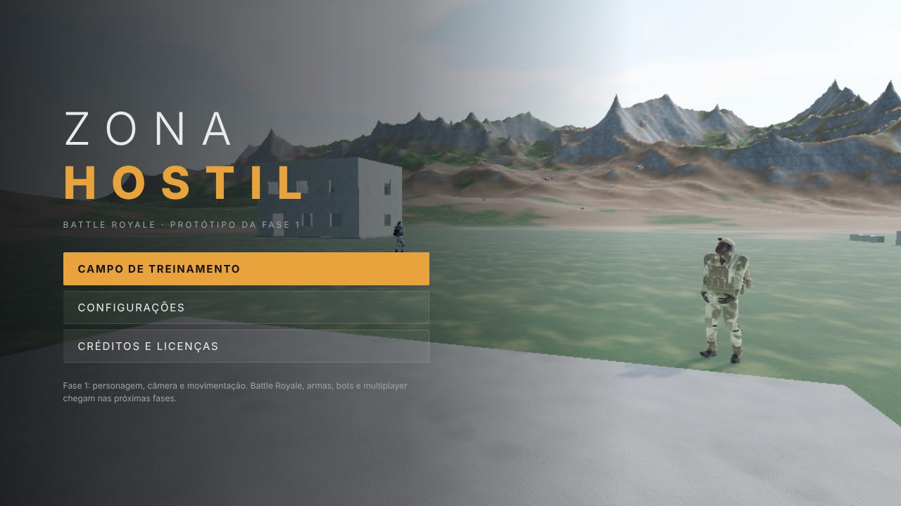
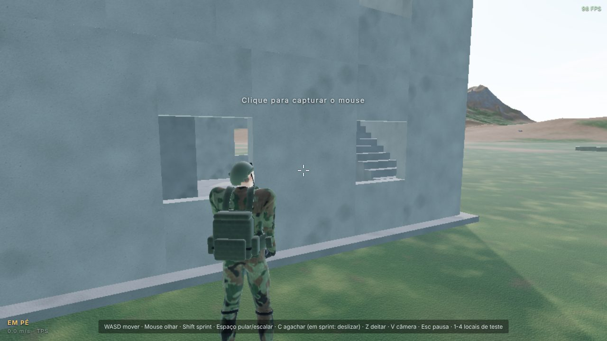
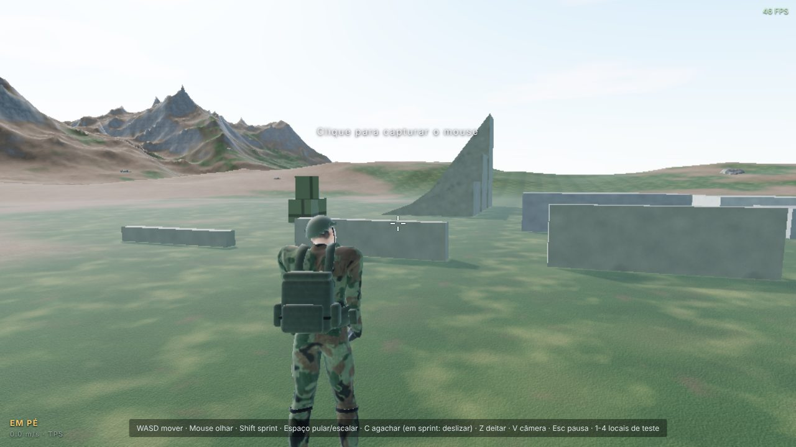
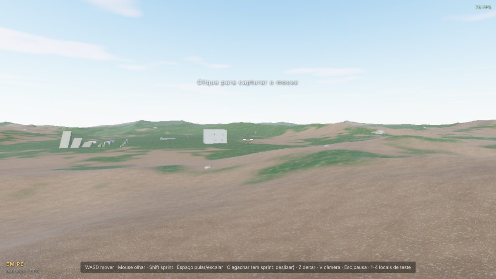

# Fase 1 — Fundação: relatório

**Escopo:** projeto, arquitetura, personagem humano, câmera e movimentação. Executado e testado no
Chromium headless (desktop e celular emulado) deste ambiente.






## O que foi construído

### Personagens humanos (pipeline próprio, `tools/character/`)
- Malha anatômica do MakeHuman (CC0) com morphs de gênero, idade, musculatura, peso, altura, proporções e etnia, lidos pelo meu próprio leitor de dados.
- **4 soldados distintos** (alfa, bravo, charlie, delta): etnias, alturas (1,71–1,83 m) e físicos diferentes, cada um com camuflagem própria (floresta, deserto, urbana, serra), gerada em 3D e sem costuras dentro das peças.
- Rosto com pele texturizada, olhos, sobrancelhas, cílios e cabelo raspado pintado no couro cabeludo.
- Uniforme de manga longa com cinto, calça presa no cano da bota e luvas táticas.
- **Equipamento modelado por script** a partir das medidas reais de cada corpo: colete porta-placas (placas frontal/traseira curvas, faixa abdominal, alças), 3 porta-carregadores, painel administrativo, rádio com antena, bolsa de granada, capacete balístico de corte alto (trilhos, suporte de visão noturna, jugular), mochila de assalto, canos de bota e joelheiras.
- Esqueleto `game_engine` (53 ossos, dedos inclusos). Os pesos de skinning do equipamento são transferidos da pele.
- Cerca de 2,3 MB por soldado (texturas de 1024 px).

### Animações de captura de movimento real (`tools/character/retarget.py`)
- Clipes da CMU redirecionados por delta de rotação em relação à T-pose: parado, andar, correr, sprint, ré, lateral (esq./dir. espelhado) e pulo.
- Detecção automática do ciclo da passada, remoção do deslocamento (in-place) e fechamento do loop.
- Na execução: blend 2D com **sincronia de fase** pelo pé de apoio, pernas orientadas para a direção do movimento com o tronco voltado para a mira, e velocidade de reprodução casada com a velocidade real (sem pé deslizando).
- **IK de duas articulações** para agachar e deslizar, e adaptação dos pés ao terreno inclinado.
- Pose **deitada** e rastejo procedurais. Mira vertical distribuída entre coluna, pescoço e cabeça.

### Movimentação (`src/player/PlayerController.ts`, `src/physics/`)
- Andar (analógico parcial), correr (4,4 m/s), **sprint** (6,6 m/s), agachar (alternar ou segurar), **deitar** (verifica espaço para o corpo), pular, **deslizar** (sprint + agachar), **escalar obstáculos** de 0,45 a 2,05 m (detecta muro, topo e espaço livre).
- Motor de cápsula com subpassos: desliza em paredes, sobe degraus de até 42 cm, rampas caminháveis até 46°, encostas íngremes fazem escorregar, encaixe no chão em descidas, teto bloqueia levantar.

### Câmera (`src/player/CameraRig.ts`)
- Primeira e terceira pessoa (alternância com V / botão FPS/TPS, salva nas configurações).
- Interpolação da física e balanço de cabeça configurável sincronizado à passada.
- Mergulho no pouso, FOV maior no sprint e deslize, inclinação no deslize.
- Em 3ª pessoa, a câmera fica sobre o ombro e **não atravessa paredes nem o terreno**.

### Mundo de teste (`src/world/`)
- Terreno 640 × 640 m com relevo real: serra ao norte, colinas e vale com leito seco (**desnível de 90 m**).
- Material com mistura grama/terra/rocha por inclinação, rocha triplanar e variação anti-repetição.
- Céu com dispersão atmosférica, sol com sombras que acompanham o jogador, neblina e IBL do céu.
- Campo de Treinamento: Casa de Treino de 2 andares com **escadas internas reais, janelas e terraço**, muros de 0,5/1,0/1,5/2,4 m, caixotes, túnel agachado (1,3 m), túnel rasteiro (0,75 m), rampas de 20°/35°/52°, escada externa com plataforma e 70 rochas com colisão.
- 3 manequins de treinamento animados (parado, patrulha andando, circuito correndo). **Não são IA**: a IA é a fase 6.

### Interface e configurações
- Telas conectadas: carregamento (com progresso), tela inicial com câmera orbitando o esquadrão, jogo, pausa, configurações e créditos.
- Configurações **funcionais e salvas**:
  - Gráficos: qualidade baixo/médio/alto/personalizado, resolução, sombras, distância de visão, limite de FPS, MSAA.
  - Controles: sensibilidade, sensibilidade de toque, inverter Y, agachar alternar/segurar.
  - Jogabilidade: câmera, FOV horizontal, balanço, FPS e depuração.
- Celular: joystick flutuante (arrastar acima da borda trava o sprint), área de câmera e botões PULAR, AGACHAR, DEITAR, CORRER, FPS/TPS e ☰.
- Gamepad (mapeamento padrão) e teclado/mouse com captura do cursor.

## Testes executados (resultados reais desta sessão)

**Unitários — Vitest (`npm test`): 14/14 passaram**
- Motor: queda e repouso, distância percorrida, rampa de 30° sobe e de 60° não, parede, deslizar em parede diagonal, degrau de 30 cm sobe e bloco de 70 cm não, altura do pulo, teto baixo e descida de rampa sem perder o chão.
- Configurações: validação de limites, persistência entre sessões, JSON corrompido.
- IK de duas articulações e continuidade do heightfield.

**Ponta a ponta — Playwright no Chromium real (`npm run test:e2e`): 25/25 passaram**

| Grupo | Verificações |
|---|---|
| Carregamento e spawn | tela inicial, jogador no chão no spawn |
| Locomoção | W anda 6,8 m, sprint a 6,6 m/s, sprint + C desliza e termina agachado, C alterna, pulo de 0,74 m e pouso |
| Posturas | agachar (olhos a 1,14 m), deitar (olhos a 0,36 m), levantar |
| Obstáculos e relevo | escala muro de 1,5 m, sobe escada até a plataforma de 1,2 m, rampa de 20° sobe e de 52° bloqueia, desnível do terreno de 90 m |
| Interface | quadro não-preto, Esc pausa, configuração salva no armazenamento |
| Celular (Pixel 7 emulado, toque via CDP) | controles visíveis, joystick move 7 m, arrastar gira a câmera, botão AGACHAR funciona |
| Console | sem erros de JavaScript |

**Bugs encontrados pelos testes e corrigidos nesta fase:**
- Escalada infinita em encosta de 60°: a projeção da velocidade criava subida.
- Subida de degrau que dependia de efeito colateral.
- Tela preta em 1ª pessoa: a mola da câmera divergia com quadros lentos.
- `mousemove` sem deslocamento zerava o movimento de outras fontes de entrada.
- Corpo do jogador bloqueando a visão em 1ª pessoa.
- Pesos do equipamento herdados das mãos.
- Sobrancelhas sumindo pelo mipmap e por material BLEND sem gravar profundidade.

## O que ainda NÃO funciona / limitações conhecidas
- **Sem armas, tiro, dano ou vida** (fase 3). A mira (botão direito/RT) não faz nada ainda e não há botão de tiro na tela de toque.
- **1ª pessoa sem braços visíveis**: os braços de viewmodel chegam junto com as armas. Hoje, em 1ª pessoa, você vê sua sombra mas não o corpo.
- Sem animação de morte, ferimento ou escada de mão (morte será por ragdoll na fase 3; escadas de mão na fase 2).
- Agachar andando é derivado do andar com IK (não é captura dedicada). Rastejar deitado é procedural e funciona, mas é mais simples que uma captura.
- Os prédios do campo de teste são blocos de concreto simples. A arquitetura detalhada é da fase 2, assim como vegetação 3D (árvores, grama) e o mapa de Battle Royale.
- Personagens sem LOD (≈ 25 mil vértices cada). Bom para poucos personagens; LOD e instâncias entram na fase 2/6.
- Sem áudio (fase 8). As configurações de áudio existem no código, mas a aba não é mostrada até haver som.
- Desempenho medido só em software (SwiftShader, sem GPU). **Correção (Fase 3):** o número "15–35 FPS" citado aqui vinha de um contador com média móvel que mostrava valores errados; o contador foi refeito (janela de 1 s) e as medições válidas estão em `docs/RELATORIO_FASES_2_A_5.md`. **Falta validar em celulares reais.** O perfil "médio" é o padrão no celular.
- Multiplayer: apenas planejado (seção 4 do plano técnico).

## Como rodar
```bash
cd zona-hostil
npm install
npm run dev          # http://localhost:5173 (use --host para abrir no celular na mesma rede)
npm test             # unitários
npm run build && npm run test:e2e   # navegador real, capturas em tests/e2e/output/
```
Controles (PC): WASD, mouse, Shift sprint, Espaço pular/escalar, C agachar (no sprint: deslizar), Z deitar,
V câmera, Esc pausa, teclas 1–4 teleportam para os locais de teste.
